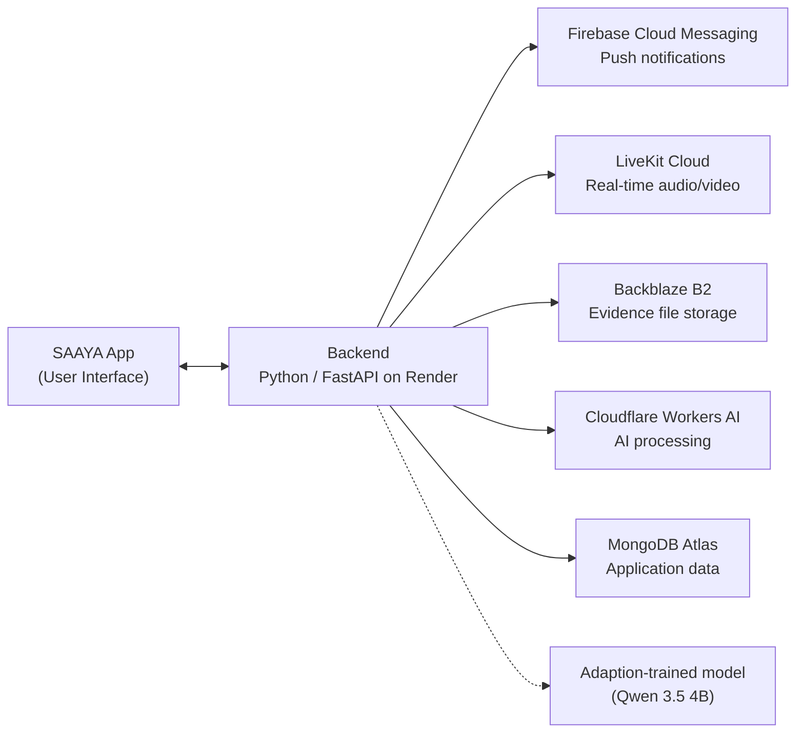

# SAAYA

### Beyond SOS. Towards Intelligent Safety.

**SAAYA is a cloud-based women's safety and emergency response platform that connects journey-based protection, real-time emergency communication, secure evidence management, and domain-specific AI-powered incident intelligence in a single system.**

> Built for **Lean In Hacks 8.0** 
---

---

## 1. Overview

Most women's safety applications are built around a single mechanism: the user feels unsafe, presses an SOS button, and emergency contacts receive an alert. This is valuable, but it addresses only one moment in a much longer process.

SAAYA treats safety as a **connected journey** rather than a single button press. It supports the user before an incident (prevention), during an incident (protection), and after an incident (documentation and understanding).

**Core philosophy:** Safety should not begin only when an emergency happens. It should be continuous, connected, and supported by technology throughout the entire incident lifecycle.

---

## 2. The Problem

Existing safety solutions commonly leave several gaps:

| Gap | Consequence |
| --- | --- |
| Alerts are the primary feature | Little support before or after an incident |
| Location sharing is basic | Contacts lack journey-level context |
| Communication is limited | Users cannot easily interact in real time during an emergency |
| Evidence is scattered | Photos, audio, video, and notes end up in different places and formats |
| Documentation is manual | Survivors must reconstruct events themselves, often under stress |

SAAYA is designed to close these gaps with one integrated platform.

---

## 3. Our Approach: The SAAYA Safety Lifecycle

| Stage | Focus | What SAAYA provides |
| --- | --- | --- |
| **Before** | Prevention | Journey monitoring, location awareness, trusted contacts |
| **During** | Protection | SOS activation, emergency escalation, notifications, real-time communication |
| **After** | Documentation | Evidence collection, secure storage, organization |
| **Intelligence** | Understanding | AI-assisted classification, summarization, timeline generation, information extraction |

The strongest differentiator of SAAYA is the link between the **immediate emergency-response system** and the **post-incident evidence-intelligence system**.

---

## 4. Key Features

### Real-Time Location Monitoring
- Access the user's current location
- Share location with trusted contacts
- Support real-time location updates
- Provide location context during emergencies

### Journey-Based Safety
1. The user starts a journey.
2. Trusted contacts can stay connected to it.
3. Location updates maintain visibility throughout the trip.
4. If something goes wrong, the user can trigger the emergency response directly from the journey.

### SOS and Emergency Escalation
1. The user triggers SOS.
2. Emergency contacts receive push notifications.
3. Relevant location information is shared.
4. Real-time communication becomes available.
5. The incident can be documented through the evidence system.

### Real-Time Communication
Audio and video communication during emergencies is powered by **LiveKit Cloud**, so SAAYA does not need to build its own real-time media infrastructure.

### Evidence Management
Users can upload and organize incident evidence in one place:
- Images and photographs
- Video recordings
- Audio recordings
- Documents
- Written incident information

Evidence files are stored using **Backblaze B2 Cloud Storage**.

---

## 5. Evidence Intelligence

Storing evidence is not enough. A pile of images, recordings, and documents is hard to search, interpret, and present. The **Evidence Intelligence** layer turns unstructured evidence into organized, structured information.

| Capability | Description |
| --- | --- |
| Incident classification | Identify the relevant incident category |
| Evidence understanding | Interpret available evidence and its context |
| Contextual summary | Generate a concise summary of the incident |
| Timeline generation | Organize events chronologically |
| Information extraction | Identify relevant details from the evidence |
| Related incident information | Connect relevant evidence and incident context |

### Processing by evidence type

| Evidence type | Processing |
| --- | --- |
| Images | Image analysis and contextual information extraction |
| Video | Video processing and context extraction |
| Audio | Whisper-based transcription |
| Documents | Text extraction and evidence understanding |

> **Important:** AI-generated summaries and classifications are decision-support aids. They are **not** verified facts and are never a substitute for the original evidence, which is always preserved and presented separately.

---

## 6. Adaption AI Integration

A general-purpose LLM can summarize text, but SAAYA has a more specialized requirement: understanding incident-related evidence, classifying situations, extracting relevant details, and producing **structured** output. We used **Adaption AI** to explore domain-specific model adaptation for this task rather than relying entirely on generic models.

### 6.1 Dataset Engineering

We built a dataset named **`SAAYA 1034 validated evidence reports (augmented)`**.

| Item | Detail |
| --- | --- |
| Source reports | 1,034 validated evidence reports |
| Dataset rows (Adaption dashboard) | 2,064 |
| Contents | Original prompts, original completions, enhanced prompts, enhanced completions, augmented examples |

The 2,064 rows are the rows shown in the dataset dashboard after augmentation. They do not represent 2,064 independently collected incidents.

The purpose of the dataset is to teach a model how to interpret evidence-related inputs and generate useful, structured responses.


### 6.2 AutoScientist

We explored Adaption AI's **AutoScientist** workflow as part of our model experimentation process, supporting our dataset-driven development and instruction-tuning work.

### 6.3 Base Model and Training

| Item | Detail |
| --- | --- |
| Base model | **Qwen 3.5 4B** |
| Approach | Instruction tuning on SAAYA-specific data |
| Monitored metrics | Training loss, validation loss, learning rate, gradient norm |

Development workflow:
1. Select the base model
2. Prepare the domain-specific dataset
3. Configure instruction tuning
4. Run training experiments
5. Monitor training metrics
6. Explore model weight exports

Training metrics help us understand optimization behaviour. They do not by themselves establish model accuracy or real-world reliability, and we do not claim they do.


### 6.3.1 Training screenshots


### 6.4 How the Adapted Model Fits Into SAAYA

```mermaid
flowchart TD
    A["User uploads incident evidence<br/>Images · Audio · Video · Documents"] --> B["Evidence preprocessing<br/>Transcription · Text extraction · Context preparation"]
    B --> C["Adaption AI: SAAYA adapted model<br/>Qwen 3.5 4B instruction-tuning workflow"]
    C --> D["Incident classification"]
    C --> E["Evidence summarization"]
    C --> F["Timeline generation"]
    C --> G["Information extraction"]
    D --> H["SAAYA Evidence Intelligence<br/>Structured, context-aware incident information"]
    E --> H
    F --> H
    G --> H
```



**Status:** Dataset preparation and instruction-tuning experimentation are completed work. Final production integration of the exported model and measured performance evaluation are **in progress**.

> Cloudflare Workers AI and the Adaption-trained model are **separate AI components**. They are not the same model or service.

---

## 7. System Architecture



### Layers

**Application layer** – User interaction, emergency controls, journey and location interfaces, evidence upload, the Evidence Intelligence interface, and communication interfaces.

**Backend layer** – A Python/FastAPI service acting as the central coordinator: processing requests, managing business logic, coordinating evidence uploads and analysis, interacting with cloud services, and connecting AI capabilities to application workflows.

**Cloud infrastructure** – Managed services for hosting, storage, messaging, real-time communication, and AI (see below).

---

## 8. Technology Stack

| Service / Technology | Role in SAAYA |
| --- | --- |
| Python / FastAPI | Backend application and API |
| Render | Backend hosting and deployment |
| MongoDB Atlas | Application data storage (database: `saaya`) |
| Backblaze B2 | Cloud storage for evidence files |
| Firebase Cloud Messaging | Push notifications |
| LiveKit Cloud | Real-time audio/video communication |
| Cloudflare Workers AI | AI processing capabilities |
| Whisper | Audio transcription |
| **Adaption AI** | **Dataset preparation and model adaptation** |
| Qwen 3.5 4B | Base model for SAAYA's adapted evidence-analysis model |

---

## 9. Security and Privacy

SAAYA handles sensitive incident and location information, so privacy is a fundamental design requirement rather than an add-on feature. Our design considers:

- Secure authentication and authorization
- Restricted access to incident-related evidence
- Secure communication between the application and backend
- Protection of uploaded files
- Secure handling of API keys and environment variables (no secrets are committed to this repository)
- Access controls for trusted contacts
- Protection of sensitive location information
- Clear separation of original evidence from AI-generated analysis

---


## 10. Installation and Setup

### Prerequisites
- Python 3.10+
- Accounts and credentials for: MongoDB Atlas, Backblaze B2, Firebase, LiveKit Cloud, Cloudflare

### Backend

```bash
# Clone the repository
git clone <your-repository-url>
cd saaya

# Create and activate a virtual environment
python -m venv venv
source venv/bin/activate        # Windows: venv\Scripts\activate

# Install dependencies
pip install -r requirements.txt

# Configure environment variables
cp .env.example .env
# Fill in the values in .env (see below)

# Run the server
uvicorn main:app --reload
```

### Environment variables

```env
MONGODB_URI=
MONGODB_DB_NAME=saaya
B2_KEY_ID=
B2_APPLICATION_KEY=
B2_BUCKET_NAME=
FIREBASE_CREDENTIALS=
LIVEKIT_URL=
LIVEKIT_API_KEY=
LIVEKIT_API_SECRET=
CLOUDFLARE_ACCOUNT_ID=
CLOUDFLARE_API_TOKEN=
```

> Never commit `.env` files, credentials, API keys, or private endpoints.

<!-- Add mobile/frontend setup instructions here -->

---


---

## 13. Future Scope

- Complete production integration of the Adaption-adapted model
- Quantitative evaluation of classification, summarization, and extraction quality
- Expanded and more diverse training data
- Multilingual support for incident reports and evidence
- Deeper integration with local emergency services
- Enhanced privacy controls and configurable evidence retention

---


